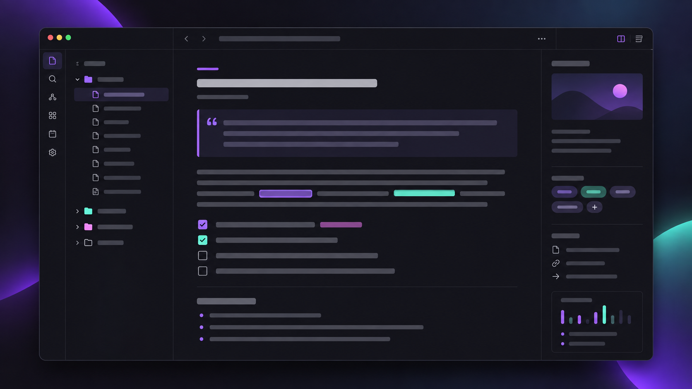

# Obsidiauranite

Obsidiauranite combines the Obsidianite layout, Aura-inspired purple and mint
palette, and Things-style checkboxes. It is a derived theme, not a from-scratch
design; see [THIRD_PARTY_LICENSES.md](THIRD_PARTY_LICENSES.md) for complete
provenance and terms.



> This is a synthetic documentation preview, not a screenshot of a real vault
> or a compatibility certification.

## Status and installation

`1.2.8` is an unreleased review draft. This repository does not claim BRAT or
automatic-update support, and this work does not publish a tag or release.

For a local beta install, choose the destination yourself and deploy explicitly:

```bash
make deploy TARGET="/path/to/your/vault/.obsidian/themes/Obsidiauranite"
```

The normal build never infers or writes to a vault. It produces only the
repository-local `theme.css`.

## Build and checks

Requirements: Bash, Make, `curl`, `patch`, `shasum`, `awk`, and Node.js.

```bash
make fetch  # downloads the exact pinned inputs and verifies their hashes
make build  # produces only theme.css in this checkout
make check  # syntax, input hashes, repeatable build, notices, contrast, deploy contract
```

`sources.lock` pins both source revisions and hashes. Obsidianite's three local
layout patches are tracked in `patches/obsidianite-local.patch`, so `make fetch`
reconstructs the same vendor file instead of overwriting them with a moving
branch. The build extracts Things rules using named boundaries and fails when an
upstream boundary changes.

## Contrast scope

`node scripts/check-contrast.mjs` measures the two deliberate text pairs used
in the documentation: dark text on the purple accent and normal text on the
dark surface. It does **not** claim that every CSS state or third-party selector
meets WCAG AA; the earlier blanket claim was unsupported.

## Release drafts

`make release-drafts` prepares review-only, notice-complete replacements under
`drafts/release-assets/`. It neither edits a GitHub Release nor uploads an
asset. The generated manifest records the original asset URLs and hashes,
proposed draft hashes, and known gaps: `v1.2.6` has no uploaded assets and the
`v1.2.7` tag has no GitHub Release.

## Contributing, support, and security

- [CONTRIBUTING.md](CONTRIBUTING.md) explains the small local workflow.
- [SUPPORT.md](SUPPORT.md) covers non-sensitive usage questions.
- [SECURITY.md](SECURITY.md) explains private vulnerability reporting without
  publishing a personal contact address.
